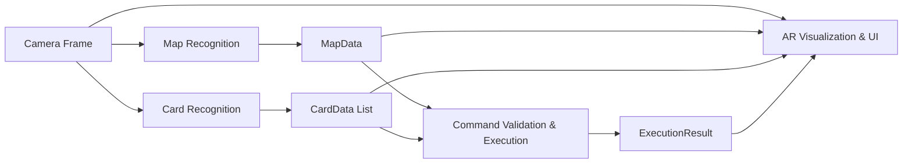

# CardRoad

**Physical Card-Based Programming with Computer Vision and Augmented Reality**

CardRoad is a tangible programming puzzle that recognizes a paper grid map and physical command cards through a webcam. Users arrange cards to build a program, then watch a blue AR character move across the real-world map according to their commands.

The project was motivated by a limitation of beginner-friendly block programming tools such as Scratch and Entry: learners still need to operate a mouse to arrange blocks. CardRoad lets them explore **sequential execution, direction changes, and loops by manipulating physical cards**.

**[▶ Watch the Demo](https://youtu.be/rR2XfpJaZC8)** · **[Project Documentation (Notion)](https://app.notion.com/p/3fe8b9caf86580b09898c8b12a11681f)**

## Features

| Component | Functionality |
| --- | --- |
| **Variable-Size Grid Recognition** | Detects printed and hand-drawn grids and identifies their dimensions, start position, goal position, and obstacles. |
| **Six Command Cards** | Recognizes physical cards, identifies their symbols, and orders commands from left to right. |
| **Command Validation and Execution** | Executes movement, turns, and two- or three-iteration loops, with syntax validation before movement. |
| **Game Result Checks** | Determines goal arrival, obstacle collisions, out-of-bounds movement, and failure to reach the goal. |
| **AR Visualization** | Overlays an animated character on the camera feed, highlights the active card, and displays execution feedback. |

## Game Components and Rules

### Grid Map

- The map consists of equally sized square cells. Grid dimensions are **not hard-coded**; tested configurations include `4×4`, `5×5`, `5×7`, and `6×6`.
- **Start** is marked in green, **Goal** in red, and **obstacles** in black or with hatching.
- The character starts at the Start cell facing **UP**.
- Grid coordinates use `(row, col)`, starting from `(0, 0)` in the top-left corner.

### Supported Command Cards

| Card | Internal Command | Behavior |
| --- | --- | --- |
| Forward (↑) | `FORWARD` | Move one cell in the current direction. |
| Turn Left (↶) | `TURN_LEFT` | Rotate 90° counterclockwise without moving. |
| Turn Right (↷) | `TURN_RIGHT` | Rotate 90° clockwise without moving. |
| Repeat ×2 | `REPEAT_2` | Execute the enclosed commands twice in total. |
| Repeat ×3 | `REPEAT_3` | Execute the enclosed commands three times in total. |
| Loop End | `LOOP_END` | Mark the end of a repeat block. |

Cards must be placed **in a single row below the map**, in their intended execution order from left to right.

For example:

```text
[Repeat ×2] → [Forward] → [Turn Right] → [Loop End]

Executed sequence:
Forward → Turn Right → Forward → Turn Right
```

Multiple separate loops are supported. **Nested loops are not supported** in the current version.

### Execution Outcomes

| Status | Condition |
| --- | --- |
| `SUCCESS` | The character reaches the goal. |
| `FAILURE` | The character hits an obstacle, attempts to leave the grid, or finishes all commands without reaching the goal. |
| `ERROR` | The program contains an invalid command or loop structure, or the map data is invalid. |

The execution engine validates the **entire command sequence before running it**. Invalid structures include unclosed loops, loop endings without a matching start, empty loops, and nested loops. If a collision or out-of-bounds move occurs, the engine retains the last valid character position and the execution history, along with the index of the card responsible for the failure.

## Getting Started

### Requirements

- **Python 3.10 or newer**
- A webcam or another camera recognized as a webcam by the operating system
- A printed or hand-drawn grid map and physical command cards
- A desktop environment capable of displaying OpenCV windows

The Python dependencies are listed in `requirements.txt`: **NumPy**, **OpenCV**, and **Pillow**. The Noto Sans KR font used by the Korean-language UI is bundled with the project.

### Installation (Windows / PowerShell)

Open a terminal and run:

```powershell
git clone https://github.com/kda5337/basic_vision_card_road.git
cd basic_vision_card_road

python -m venv .venv
.\.venv\Scripts\python.exe -m pip install -r requirements.txt
.\.venv\Scripts\python.exe main.py
```

If your camera uses an index other than `0`, specify it explicitly:

```powershell
.\.venv\Scripts\python.exe main.py --camera 1
```

On macOS or Linux, create and activate a virtual environment with `python3 -m venv .venv` and `source .venv/bin/activate`, then install the requirements and run `python main.py`. Camera and OpenCV GUI support may vary by system.

### How to Play

1. Fix the camera in a **top-down view**.
2. Place the grid map above the command cards, keeping both fully visible in the camera frame.
3. Minimize shadows, reflections, and severe perspective distortion.
4. Run `main.py` and check the live camera preview.
5. Click the **Start** button or press `S`/`Space`. CardRoad captures the current frame, recognizes the map and cards, and simulates the command sequence.
6. Watch the AR movement, active-card highlighting, and final result. Rearrange the cards and start again to try another solution.

### Keyboard and Mouse Controls

| Control | Action |
| --- | --- |
| `S`, `Space`, or on-screen **Start** | Recognize the map and cards, then start or restart the game. |
| `M` | Inspect map recognition (grid dimensions, markers, obstacles). |
| `C` | Inspect card recognition (order, commands, confidence scores). |
| `R` | Return from a diagnostic view to the live camera preview. |
| `Q` or `Esc` | Quit. |

> **Note:** Map and card recognition occurs when a run starts. The AR overlay uses the coordinates obtained at that moment; it does **not** continuously track a moving camera or board. If the setup moves, start a new run to recognize it again.

## System Architecture



All modules share the data structures defined in [`common/models.py`](common/models.py).

| Module | Main Responsibilities | Input → Output |
| --- | --- | --- |
| [`map_recognition.py`](modules/map_recognition.py) | Grid detection, perspective correction, and cell classification | `frame` → `DetectionResult[MapData]` |
| [`card_recognition.py`](modules/card_recognition.py) | Card detection, symbol matching, and left-to-right ordering | `frame` → `DetectionResult[list[CardData]]` |
| [`command_processor.py`](modules/command_processor.py) | Loop validation, command expansion, simulation, and game result checks | `MapData`, `list[Command]` → `ExecutionResult` |
| [`ar_visualization.py`](modules/ar_visualization.py) | Coordinate mapping, movement animation, card highlighting, and UI | `MapData`, `CardData`, `ExecutionResult`, `frame` → rendered frame |
| [`main.py`](main.py) | Camera handling, module integration, diagnostics, and error handling | End-to-end application |

### Key Implementation Techniques

**1. Map Recognition**  
The system detects quadrilateral grid candidates using contour analysis, then applies `cv2.getPerspectiveTransform()` and `cv2.warpPerspective()` to obtain a top-down representation. HSV and intensity-based analysis identify Start, Goal, and obstacle cells. For hand-drawn grids, morphological closing, directional stroke extraction, and `cv2.HoughLinesP()` help recover broken or slanted lines.

**2. Card Recognition**  
Edge detection and contour filtering locate candidate cards. Each card is perspective-corrected, and its symbol is compared with templates for the six supported commands. Detected cards are sorted by horizontal position; the resulting data includes the command, bounding box, and recognition confidence.

**3. Command Processing**  
The engine checks map validity and loop syntax, expands repeat blocks into executable commands, and preserves the original card indices. Every valid movement or turn produces an `ExecutionStep`. The final `ExecutionResult` includes the status, execution history, final state, and relevant error information.

**4. AR Visualization**  
Map corner coordinates define a transformation from grid coordinates to camera pixels. The visualizer interpolates character movement and rotation, draws a blue triangle on the live frame, highlights the currently executed card, and displays Korean-language status and result messages.

## Repository Structure

```text
basic_vision_card_road/
├── main.py                       # End-to-end application
├── common/
│   └── models.py                 # Shared enums and data models
├── modules/
│   ├── map_recognition.py        # Grid and marker recognition
│   ├── card_recognition.py       # Card detection and classification
│   ├── command_processor.py      # Command validation and simulation
│   ├── ar_visualization.py       # AR rendering and UI
│   └── assets/fonts/             # Bundled Korean font
├── templates/                    # Six command-symbol templates
├── test_pictures/                # Test images
├── examples/                     # Standalone demos and experiments
├── tests/                        # Automated tests
├── docs/                         # Additional development notes
└── requirements.txt
```

## Testing and Standalone AR Demo

Run the available automated tests with:

```powershell
.\.venv\Scripts\python.exe -m unittest discover -s tests -v
```

To explore AR rendering independently of physical card or grid recognition, run:

```powershell
.\.venv\Scripts\python.exe -m examples.demo_ar
```

The standalone demo uses predefined map data and execution records. **It is not an end-to-end recognition test.** Use `main.py` to run the integrated webcam application.

## Limitations and Future Work

- **Recognition robustness:** Lighting, reflections, shadows, and camera angle can affect grid and card recognition.
- **Map symbols:** The current implementation relies primarily on color and intensity for Start, Goal, and obstacle detection. Recognizing a wider variety of icons remains future work.
- **AR tracking:** Grid coordinates are fixed for each run. Continuous tracking of a moving camera or board has not been implemented.
- **Programming features:** Conditional statements and nested loops are planned extensions, not current features.

## Team

**Team H · Gachon University Computer Vision Project**

| Member | Contribution |
| --- | --- |
| **Kang Hohyeon (강호현)** | Project management, system integration (`main.py`), integration testing, documentation, and presentation |
| **Kim Dana (김단아)** | Variable-size grid detection, perspective correction, and map cell classification |
| **Song Junghyun (송중현)** | Card detection, symbol recognition, and command ordering |
| **Yoo Byunghoon (유병훈)** | Command validation, loop handling, simulation, and result evaluation |
| **Kang Juwon (강주원)** | AR character rendering, animation, active-card highlighting, and UI |

## Resources

- [Recorded Demo (YouTube)](https://youtu.be/rR2XfpJaZC8)
- [Project Documentation (Notion)](https://app.notion.com/p/3fe8b9caf86580b09898c8b12a11681f)
- [AR Development Notes](docs/ar_development.md)

