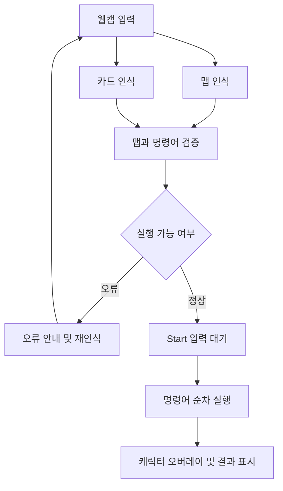

# CardRoad
# 이거 수정해야 됩니다
### 현실에서 그린 맵과 실물 명령어 카드로 푸는 코딩 퍼즐

CodeCanvas는 종이에 그린 격자 맵과 실물 명령어 카드를 웹캠으로 인식하여, 화면 속 캐릭터를 움직이는 코딩 학습 프로젝트입니다.

사용자는 장애물, 출발점, 도착점이 있는 맵을 직접 만들고 명령어 카드를 순서대로 배치합니다. 프로그램은 맵과 카드를 인식한 뒤, 명령을 실행하여 캐릭터가 도착점까지 이동할 수 있는지 확인합니다.

> 현재 개발 기획 단계이며, 아래 내용은 구현 목표와 설계 방향을 설명합니다.

## 1. 프로젝트 목표

- 종이와 실물 카드를 활용하여 코딩을 직관적으로 경험할 수 있도록 합니다.
- 캐릭터의 이동을 통해 순차 실행과 반복문의 동작 원리를 이해하도록 돕습니다.
- 사용자가 직접 맵과 명령을 구성하고, 실행 결과를 보며 문제를 해결하도록 합니다.
- 카메라로 인식한 실제 맵 위에 캐릭터의 이동을 표시합니다.

## 2. 사용 방법

1. **맵 그리기**
   - 종이에 격자 맵을 그립니다.
   - 장애물, 출발점, 도착점을 표시합니다.
   - 캐릭터의 시작 방향을 표시합니다.

2. **명령어 카드 배치**
   - 캐릭터가 도착점에 도달하도록 명령어 카드를 순서대로 배치합니다.
   - 반복이 필요한 구간에는 반복 시작 카드와 반복 끝 카드를 사용합니다.

3. **인식 결과 확인**
   - 웹캠에 맵과 명령어 카드가 모두 보이도록 배치합니다.
   - 화면에서 맵과 카드의 인식 결과를 확인합니다.

4. **Start 버튼 클릭**
   - 인식된 맵과 명령어를 기준으로 실행을 시작합니다.

5. **실행 결과 확인**
   - 캐릭터가 명령어 순서에 따라 이동합니다.
   - 도착점에 도달하면 성공, 장애물에 부딪히면 실패합니다.
   - 맵이나 명령어를 수정하여 다시 도전합니다.

## 3. 명령어 카드

| 카드 | 기능 | 동작 |
| --- | --- | --- |
| 전진 | 한 칸 이동 | 현재 바라보는 방향으로 한 칸 이동 |
| 왼쪽 90° 방향 전환 | 왼쪽으로 회전 | 현재 위치에서 방향만 왼쪽으로 90° 변경 |
| 오른쪽 90° 방향 전환 | 오른쪽으로 회전 | 현재 위치에서 방향만 오른쪽으로 90° 변경 |
| 반복 시작 ×N | 반복 구간 시작 | 반복 끝 카드까지의 명령을 N번 실행 |
| 반복 끝 | 반복 구간 종료 | 반복할 명령어 범위의 끝을 표시 |

- 방향 전환은 캐릭터의 위치를 변경하지 않습니다.
- 반복 횟수 N은 반복 구간의 총 실행 횟수입니다.
- 초기 구현에서는 중첩 반복문을 지원하지 않습니다.

### 반복 실행 예시

다음과 같이 카드를 배치합니다.

```text
[반복 시작 ×3] → [전진] → [오른쪽 90° 방향 전환] → [반복 끝]
```

실행되는 명령은 다음과 같습니다.

```text
1회차: 전진 → 오른쪽 90° 방향 전환
2회차: 전진 → 오른쪽 90° 방향 전환
3회차: 전진 → 오른쪽 90° 방향 전환
```

## 4. 주요 기능

### 맵 인식
- 카메라 영상에서 종이와 격자 영역을 검출합니다.
- 촬영 각도에 따른 기울어짐을 보정합니다.
- 각 칸의 위치를 좌표로 변환합니다.
- 장애물, 출발점, 도착점 및 시작 방향을 인식합니다.

### 명령어 카드 인식
- 카메라 영상에서 명령어 카드 영역을 검출합니다.
- 카드 종류와 반복 횟수를 식별합니다.
- 카드의 배치 순서에 따라 명령어 목록을 생성합니다.
- 초기 구현에서는 카드를 한 줄로 배치하고 왼쪽에서 오른쪽으로 읽습니다.

### 명령어 검증 및 실행
- 반복 시작과 반복 끝 카드의 짝을 확인합니다.
- 지원하지 않는 중첩 반복이나 잘못된 명령 구성을 검사합니다.
- 명령에 따라 캐릭터의 위치와 방향을 갱신합니다.
- 이동할 칸이 장애물인지, 맵의 범위를 벗어나는지 확인합니다.

### 실행 화면
- 인식된 맵 위에 캐릭터를 겹쳐 표시합니다.
- 현재 실행 중인 명령어와 이동 상태를 표시합니다.
- 성공, 실패 및 인식 오류를 안내합니다.
- 초기 위치로 돌아가 다시 실행할 수 있도록 합니다.

## 5. 처리 흐름



Start 버튼을 누르면 해당 시점에 확인된 맵과 명령어를 실행 데이터로 사용합니다. 실행 도중 카메라 인식 결과가 바뀌더라도 실행 중인 명령이 변경되지 않도록 설계합니다.

## 6. 게임 규칙

### 맵 구성
- 출발점과 도착점은 각각 하나씩 배치합니다.
- 장애물은 통과할 수 없습니다.
- 캐릭터는 상하좌우 네 방향 중 하나를 바라봅니다.
- 전진 명령 한 번에 한 칸씩 이동합니다.

### 실행 결과

| 상황 | 처리 |
| --- | --- |
| 도착점 도달 | 성공 처리 후 실행 종료 |
| 장애물로 이동 시도 | 실패 처리 후 실행 종료 |
| 맵 바깥으로 이동 시도 | 실패 처리 후 실행 종료 |
| 모든 명령을 실행했지만 도착점에 도달하지 못함 | 도착 실패 안내 |
| 맵이나 명령어 구성이 유효하지 않음 | 실행 전 오류 안내 |

### 반복문 검증
- 반복 시작 카드에는 대응하는 반복 끝 카드가 있어야 합니다.
- 반복 시작 없이 반복 끝 카드만 사용할 수 없습니다.
- 반복 횟수는 1 이상의 정수여야 합니다.
- 비어 있는 반복 구간과 중첩 반복문은 초기 구현에서 허용하지 않습니다.

## 7. 기술 스택 — 제안

실제 개발 과정에서 인식 방식과 화면 구현 범위에 맞게 조정합니다.

| 구분 | 기술 | 활용 목적 |
| --- | --- | --- |
| 개발 언어 | Python | 영상 처리와 실행 로직 구현 |
| 영상 처리 | OpenCV | 웹캠 입력, 영역 검출, 원근 보정, 화면 오버레이 |
| 데이터 처리 | NumPy | 영상 배열 및 격자 데이터 처리 |
| 초기 실행 화면 | OpenCV 창 및 키보드·마우스 입력 | 인식 결과 표시와 실행 제어 |
| 테스트 | pytest | 이동, 회전, 반복문 및 충돌 판정 검증 |

카드 인식은 초기에는 색상, 고정된 도안 또는 식별 마커를 활용하는 방식을 검토합니다. 인식 성능과 사용성을 확인한 뒤 필요에 따라 학습 기반 방식으로 확장합니다.

## 8. 구성 모듈 — 설계안

| 모듈 | 역할 |
| --- | --- |
| 카메라 입력 | 웹캠 연결 및 프레임 수신 |
| 맵 인식 | 격자 검출, 좌표 변환, 장애물·출발점·도착점 인식 |
| 카드 인식 | 카드 검출, 종류 식별, 배치 순서 추출 |
| 명령어 해석 | 반복 구간 분석 및 명령어 유효성 검증 |
| 실행 엔진 | 캐릭터의 위치·방향 갱신, 충돌 및 성공 판정 |
| 화면 표시 | 맵 위 캐릭터 오버레이, 실행 상태와 결과 안내 |

영상 인식과 게임 실행 로직을 분리하여, 카메라 없이도 예제 맵과 명령어로 실행 엔진을 검증할 수 있도록 구성합니다.

## 9. 개발 계획

### 1단계. 요구사항 및 입력 규격 정의
- 격자 크기와 맵 표시 규칙 결정
- 장애물, 출발점, 도착점 및 시작 방향의 도안 정의
- 명령어 카드 디자인과 배치 규칙 결정
- 성공·실패 조건과 오류 처리 방식 정의

### 2단계. 실행 엔진 구현
- 예제 격자 데이터로 캐릭터 이동 구현
- 좌우 회전 및 방향 관리
- 장애물 충돌과 맵 경계 검사
- 반복문 해석 및 실행
- 도착점 도달 여부 판정

### 3단계. 맵 인식 구현
- 웹캠 입력 연결
- 종이 영역 검출 및 원근 보정
- 격자 좌표 추출
- 맵 요소 인식 결과를 실행 엔진 데이터로 변환

### 4단계. 카드 인식 구현
- 카드 영역 검출 및 종류 식별
- 카드 배치 순서 추출
- 반복 횟수 인식
- 잘못된 카드 구성 안내

### 5단계. 화면 통합
- Start 및 초기화 기능 연결
- 카메라 영상 위 캐릭터 표시
- 명령 실행 과정과 결과 시각화

### 6단계. 검증 및 개선
- 조명, 촬영 각도, 카드 간격에 따른 인식 확인
- 다양한 맵과 명령 조합으로 실행 결과 검증
- 사용자 피드백을 바탕으로 인식 및 안내 방식 개선

## 10. 주요 검증 항목

- [ ] 출발점, 도착점, 장애물이 올바른 격자 좌표로 변환되는가?
- [ ] 캐릭터의 시작 방향이 올바르게 반영되는가?
- [ ] 카드가 배치된 순서대로 인식되는가?
- [ ] 전진 시 현재 방향으로 정확히 한 칸 이동하는가?
- [ ] 방향 전환 시 위치가 유지되는가?
- [ ] 반복 구간이 지정한 횟수만큼 실행되는가?
- [ ] 잘못된 반복문 구성을 실행 전에 차단하는가?
- [ ] 장애물과 맵 경계를 정확하게 판정하는가?
- [ ] 도착점에 도달하면 즉시 성공 처리되는가?
- [ ] 초기화 시 출발 위치와 시작 방향이 복원되는가?

## 11. 초기 구현 범위 및 제한

- 정해진 규격의 격자 맵과 카드 도안을 사용합니다.
- 명령어 카드는 한 줄로 배치합니다.
- 중첩 반복문은 지원하지 않습니다.
- 조건문, 함수 및 여러 캐릭터의 동시 실행은 초기 구현 범위에 포함하지 않습니다.
- 조명, 그림자, 종이의 기울기, 카드 가림 등은 인식 성능에 영향을 줄 수 있습니다.

## 12. 설치 및 실행

개발 환경과 실행 진입점이 확정되면 다음 내용을 추가할 예정입니다.

- 지원 Python 버전
- 의존성 설치 방법
- 카메라 설정 방법
- 프로그램 실행 명령
- 맵 및 명령어 카드 출력 자료

## 13. 기대 효과

- 명령어의 순서에 따라 결과가 달라지는 순차 실행을 이해할 수 있습니다.
- 반복되는 동작을 반복문으로 표현하는 방법을 익힐 수 있습니다.
- 실행 결과를 보고 명령을 수정하는 디버깅 과정을 경험할 수 있습니다.
- 직접 만든 맵을 활용하여 다양한 난이도의 코딩 퍼즐을 구성할 수 있습니다.
